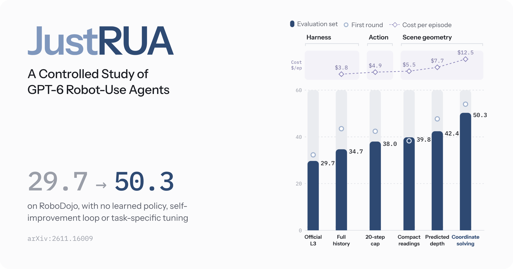
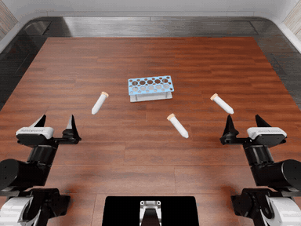
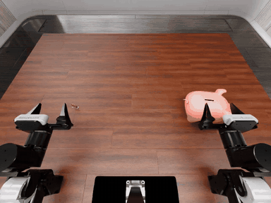
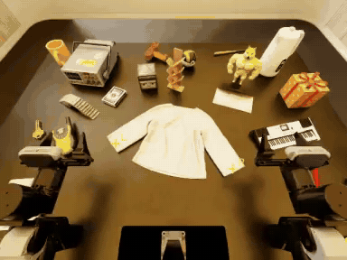
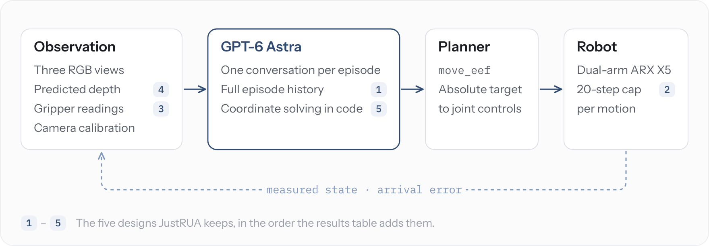

<p align="center">
  <a href="https://zefanw.github.io/JustRUA/"></a>
</p>

<p align="center">
  <a href="https://arxiv.org/abs/2611.16009">Paper</a> ·
  <a href="https://zefanw.github.io/JustRUA/">Project page</a> ·
  <a href="https://zefanw.github.io/JustRUA/media/hero/justrua-film-v10.mp4">Film</a> ·
  <a href="https://huggingface.co/spaces/ZefanW/robodojo-replay-explorer">Episode replays</a> ·
  <a href="README_zh.md">中文</a>
</p>

GPT-6 Astra can drive a robot arm directly through a harness, and scores on RoboDojo have risen quickly since. Reported systems differ in harness and test subset and often change several designs at once, so it is hard to tell which choices produce the gains. JustRUA takes these designs apart, tests them one at a time in one framework, and keeps only what matters most. With no learned policy, self-improvement loop or task-specific tuning, the score on the RoboDojo simulation benchmark rises from 29.7 to 50.3.

This repository holds the resulting policy, ready to run in RoboDojo. Every design we tested, kept or not, is on the [project page](https://zefanw.github.io/JustRUA/) with its score, cost and rollouts.

<p align="center">
  
  
  
</p>
<p align="center">
  <sub><code>insert_tubes</code>, <code>deposit_coin</code> and <code>fold_clothes</code>, sped up. More in the <a href="https://huggingface.co/spaces/ZefanW/robodojo-replay-explorer">episode replays</a>.</sub>
</p>

## Findings

- **A lean harness goes a long way.** Keeping the full episode history and stopping each motion after 20 control steps lift the score from 29.7 to 38.0. Relative targets, named skills and model-chosen step counts do not beat plain absolute targets. [Details](https://zefanw.github.io/JustRUA/#sec-harness)
- **Reusing experience is not a free lunch.** Demonstrations and a self-written skill library change how the model acts, but neither clearly beats the default, and both make an episode more expensive. They draw on the tasks being scored, so JustRUA keeps neither. [Details](https://zefanw.github.io/JustRUA/#sec-exp)
- **Scene geometry helps most.** Depth images cut empty grasps from 41 to 16, even when Depth Pro predicts the depth from RGB alone and is off by tens of centimetres. With code that solves 3D coordinates from pixels and no decision cap, the score reaches 50.3. [Details](https://zefanw.github.io/JustRUA/#sec-geo)
- **Remaining failures are mostly long-tail.** Most failures left in our best configuration are specific to one task, such as plans that do not suit the arm, unplanned knocks and slipping grasps. Fixing them would take trial and error on each task, which comes close to tuning on the test tasks. [Details](https://zefanw.github.io/JustRUA/#sec-err)

## Results

Scores are on the 111-episode RoboDojo evaluation set of the paper, which covers all 42 tasks. Each row adds one change to the row above, and the last row is the policy in this repository. Cost is per first-round episode.

| | Configuration | Score | Success (%) | Cost ($) |
| --- | --- | --- | --- | --- |
| | Official L3 harness | 29.7 | | |
| 1 | + Codex session with the full episode history | 34.7 | 27.1 | 3.76 |
| 2 | + At most 20 control steps per motion | 38.0 | 31.0 | 4.94 |
| 3 | + Compact robot readings | 39.8 | 33.3 | 5.51 |
| 4 | + Depth predicted from RGB | 42.4 | 35.4 | 7.74 |
| 5 | + Coordinate solving in code, no decision cap (**JustRUA**) | 50.3 | 43.3 | 12.53 |

The paper reports every design we tested, including the ones this policy leaves out.

## How it works

<p align="center">
  
</p>

One persistent GPT-6 Astra conversation controls each episode. At every decision the actor sees three RGB views, a depth estimate for each view, camera calibration, and measured finger and wrist readings. A close command can coexist with fingers that stop partway, and the next decision sees both the command and the measured positions.

The actor can use a local coding runtime to calculate a target from the observations, inspect its previous work, or issue an absolute end-effector target directly. The Cartesian planner converts that target into robot controls. Each motion executes at most its first 20 controls. The actor then sees the actual state and arrival error before deciding again. There is no policy limit on decision count; the simulator enforces its own episode budget.

## Use with XPolicyLab

This repository contains the complete JustRUA policy adapter. It runs inside the public RoboDojo and XPolicyLab projects. Install from the three public repositories below. A full evaluation also requires RoboDojo's simulator and assets, the external Depth Pro checkpoint, and an existing provider account with access to the selected actor. Model usage comes to about $12.5 per episode.

From a **new workspace**:

```bash
git clone https://github.com/ZefanW/JustRUA.git
git clone --filter=blob:none https://github.com/RoboDojo-Benchmark/RoboDojo.git
export ROBODOJO_ROOT="$(cd RoboDojo && pwd)"

git -C "$ROBODOJO_ROOT" submodule update --init XPolicyLab
XPL="$ROBODOJO_ROOT/XPolicyLab"
XPL_REV=6baccd57ff958570d0db1588370289ee36c8bb70
git -C "$XPL" fetch origin "$XPL_REV"
git -C "$XPL" checkout --detach "$XPL_REV"

# Copy the adapter into an empty policy slot.
test ! -e "$XPL/policy/JustRUA" && cp -R JustRUA/policy/JustRUA "$XPL/policy/"
cd "$XPL"
```

With an existing RoboDojo installation, use its XPolicyLab checkout if it already includes the Direct EEF planner. The revision above is the tested base. Follow the [adapter setup and evaluation instructions](policy/JustRUA/README.md) from the XPolicyLab root. They include commands for installing the depth model and the coding runtime, running an offline WebSocket check, and evaluating a task.

## Source map

| Directory or file | What it does |
| --- | --- |
| [observations/](policy/JustRUA/observations) | Reads robot and camera measurements, and predicts colorized depth from RGB. |
| [actor/](policy/JustRUA/actor) | Keeps one native coding conversation per episode and isolates its writable scratch space. |
| [policy.py](policy/JustRUA/policy.py) | Applies the control limit to a planned motion and passes measured feedback to the next decision. |
| [deploy.py](policy/JustRUA/deploy.py) | Connects those components to RoboDojo's environment and XPolicyLab's planner. |

## Citation

```bibtex
@article{justrua2026,
  title   = {JustRUA: A Controlled Study of GPT-6 Robot-Use Agents},
  author  = {Zefan Wang and Yufan Dang and Xuanwei Shi and Mingqi Gao and Cheng Yin and SikYuen Tam and Hanyu Liu and Yasheng Wang and Yaxi Lu and Songyang Zhang and Xin Cong and Yuan Yao},
  journal = {arXiv preprint arXiv:2611.16009},
  year    = {2026}
}
```

## License

The adapter is distributed under [Apache License 2.0](LICENSE). The robot measurement implementation in [observations/](policy/JustRUA/observations/LICENSE) includes code covered by its accompanying MIT license. Apple distributes the Depth Pro weights separately under the terms on the [pinned model card](https://huggingface.co/apple/DepthPro-hf/blob/de816c8ce7168afcb231f96d501d72b869d0beda/README.md).
