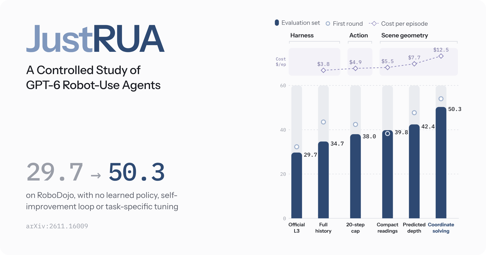
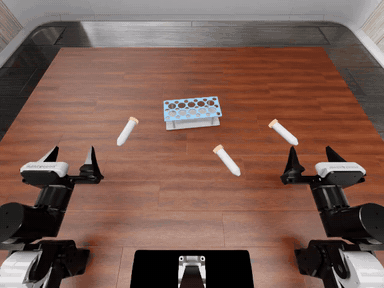
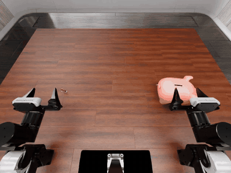
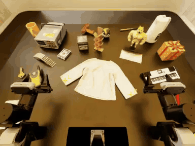
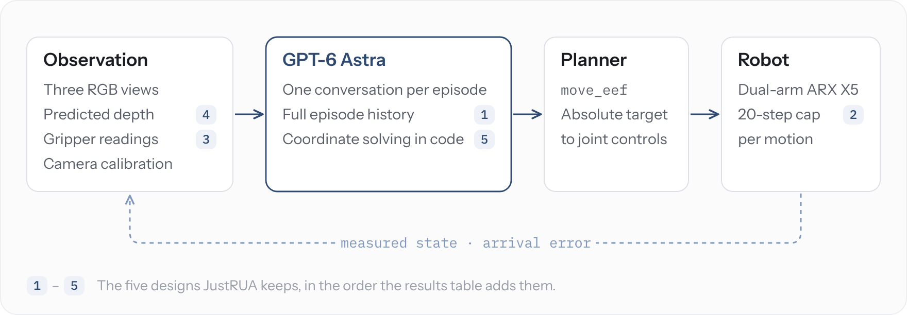

<p align="center">
  <a href="https://zefanw.github.io/JustRUA/zh/"></a>
</p>

<p align="center">
  <a href="https://arxiv.org/abs/2611.16009">论文</a> ·
  <a href="https://zefanw.github.io/JustRUA/zh/">项目主页</a> ·
  <a href="https://zefanw.github.io/JustRUA/media/hero/justrua-film-v10.mp4">影片</a> ·
  <a href="https://huggingface.co/spaces/ZefanW/robodojo-replay-explorer">回合回放</a> ·
  <a href="README.md">English</a>
</p>

GPT-6 Astra 可以通过一套 harness 直接控制机械臂，此后 RoboDojo 上的分数涨得很快。已有系统所用的 harness 和测试子集各不相同，而且常常同时改动好几处设计，很难看出提升到底来自哪些选择。JustRUA 把这些设计拆开，放在同一个框架里一次只测一项，只保留最关键的部分。不用学习得到的策略和自我改进循环，也不针对任务调参，RoboDojo 仿真基准上的得分从 29.7 提高到 50.3。

这个仓库是最终得到的策略，可以直接在 RoboDojo 里运行。所有测试过的设计，无论是否保留，都连同得分、开销和回放放在[项目主页](https://zefanw.github.io/JustRUA/zh/)上。

<p align="center">
  
  
  
</p>
<p align="center">
  <sub><code>insert_tubes</code>、<code>deposit_coin</code> 和 <code>fold_clothes</code>，已加速。更多回合见<a href="https://huggingface.co/spaces/ZefanW/robodojo-replay-explorer">回放页面</a>。</sub>
</p>

## 主要发现

- **简洁的 harness 已经能做很多。** 保留完整的回合历史，并让每段运动在 20 个控制步后停下，得分就从 29.7 提高到 38.0。相对目标、命名技能和让模型自己选步数，都没有比简单的绝对目标更好。[详情](https://zefanw.github.io/JustRUA/zh/#sec-harness)
- **复用经验并非免费午餐。** 示范和模型自己写的技能库会改变模型的做法，但都没有明显好过默认配置，每个回合的花费也更高。它们用到的正是被评分的任务，所以 JustRUA 都没有采用。[详情](https://zefanw.github.io/JustRUA/zh/#sec-exp)
- **场景几何帮助最大。** 加入深度图后，空抓从 41 次降到 16 次，哪怕深度是 Depth Pro 仅凭 RGB 预测的、误差有几十厘米，效果依然明显。再加上从像素解算 3D 坐标的代码并取消决策上限，得分达到 50.3。[详情](https://zefanw.github.io/JustRUA/zh/#sec-geo)
- **余下的失败大多是长尾问题。** 最佳配置剩下的失败大多只出现在单个任务上，比如规划不适合机械臂、计划外的碰撞和抓取打滑。要修好它们只能逐个任务反复试错，这已经接近在测试任务上调参。[详情](https://zefanw.github.io/JustRUA/zh/#sec-err)

## 结果

得分来自论文的 111 回合评测集，覆盖 RoboDojo 全部 42 个任务。每一行在上一行的基础上只加一项，最后一行就是本仓库的策略。开销按首轮回合计算。

| | 配置 | 得分 | 成功率（%） | 开销（美元） |
| --- | --- | --- | --- | --- |
| | 官方 L3 harness | 29.7 | | |
| 1 | + Codex 会话，保留完整的回合历史 | 34.7 | 27.1 | 3.76 |
| 2 | + 每段运动最多执行 20 个控制步 | 38.0 | 31.0 | 4.94 |
| 3 | + 紧凑的机器人读数 | 39.8 | 33.3 | 5.51 |
| 4 | + 由 RGB 预测的深度 | 42.4 | 35.4 | 7.74 |
| 5 | + 用代码解算坐标，取消决策上限（**JustRUA**） | 50.3 | 43.3 | 12.53 |

论文里有全部测试过的设计，包括这个策略没有采用的那些。

## 工作方式

<p align="center">
  
</p>

每个回合由一段持续的 GPT-6 Astra 对话控制。每次决策时，模型会看到三个视角的 RGB 图像、每个视角的预测深度、相机标定，以及实测的手指和腕部读数。夹爪收到闭合指令却停在半途时，下一次决策能同时看到指令和实测位置。

模型可以用本地的代码运行环境从观察里算出目标，也可以回看自己之前的工作，或者直接给出绝对的末端位姿目标。笛卡尔规划器把目标转换成机器人控制量，每段运动最多执行前 20 步，之后模型看到实际状态和到位误差，再做下一次决策。策略本身不限制决策次数，回合预算由仿真器控制。

## 在 XPolicyLab 中使用

这个仓库包含完整的 JustRUA 策略适配器，运行在公开的 RoboDojo 和 XPolicyLab 项目里，按下面三个公开仓库安装即可。完整评测还需要 RoboDojo 的仿真器和资产、外部的 Depth Pro 权重，以及能访问所选模型的账号。模型调用的开销约为每回合 12.5 美元。

在一个**新的工作目录**里：

```bash
git clone https://github.com/ZefanW/JustRUA.git
git clone --filter=blob:none https://github.com/RoboDojo-Benchmark/RoboDojo.git
export ROBODOJO_ROOT="$(cd RoboDojo && pwd)"

git -C "$ROBODOJO_ROOT" submodule update --init XPolicyLab
XPL="$ROBODOJO_ROOT/XPolicyLab"
XPL_REV=6baccd57ff958570d0db1588370289ee36c8bb70
git -C "$XPL" fetch origin "$XPL_REV"
git -C "$XPL" checkout --detach "$XPL_REV"

# 把适配器复制到一个空的策略目录
test ! -e "$XPL/policy/JustRUA" && cp -R JustRUA/policy/JustRUA "$XPL/policy/"
cd "$XPL"
```

如果已经装好了 RoboDojo，并且其中的 XPolicyLab 已包含 Direct EEF 规划器，可以直接用它。上面的版本号是测试过的基线。之后在 XPolicyLab 根目录下按[适配器的安装与评测说明](policy/JustRUA/README.md)（英文）操作，其中有安装深度模型和代码运行环境、离线检查 WebSocket、评测单个任务的命令。

## 代码结构

| 目录或文件 | 作用 |
| --- | --- |
| [observations/](policy/JustRUA/observations) | 读取机器人和相机的测量值，并由 RGB 预测彩色深度图。 |
| [actor/](policy/JustRUA/actor) | 为每个回合维持一段代码对话，并隔离它可写的临时空间。 |
| [policy.py](policy/JustRUA/policy.py) | 对规划出的运动施加控制步上限，并把实测反馈交给下一次决策。 |
| [deploy.py](policy/JustRUA/deploy.py) | 把以上部件接到 RoboDojo 的环境和 XPolicyLab 的规划器上。 |

## 引用

```bibtex
@article{justrua2026,
  title   = {JustRUA: A Controlled Study of GPT-6 Robot-Use Agents},
  author  = {Zefan Wang and Yufan Dang and Xuanwei Shi and Mingqi Gao and Cheng Yin and SikYuen Tam and Hanyu Liu and Yasheng Wang and Yaxi Lu and Songyang Zhang and Xin Cong and Yuan Yao},
  journal = {arXiv preprint arXiv:2611.16009},
  year    = {2026}
}
```

## 许可

适配器以 [Apache License 2.0](LICENSE) 发布。[observations/](policy/JustRUA/observations/LICENSE) 中的机器人测量实现包含受其附带 MIT 许可约束的代码。Depth Pro 权重由 Apple 另行分发，条款见其[模型卡](https://huggingface.co/apple/DepthPro-hf/blob/de816c8ce7168afcb231f96d501d72b869d0beda/README.md)。
